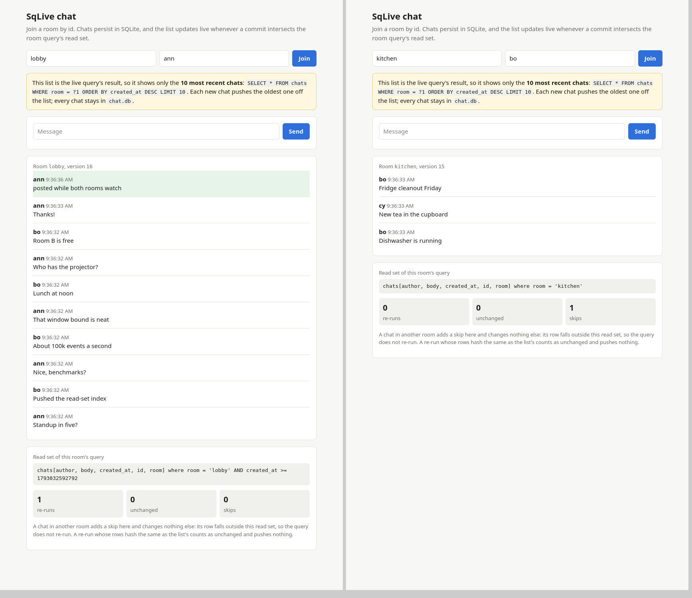

# SqLive

Live queries for SQLite. Every query returns its rows plus a **read set**: the tables,
columns, and key ranges the result depends on. Every committed write emits a
**commit event** listing the rows it changed, with old and new values.
`read_set.intersects(&event)` tells you which queries to re-run.

SqLive reports what changed and what each query depends on. Your app tracks
subscriptions and pushes updates to clients.

Status: every phase in [`PLAN.md`](PLAN.md) is built and tested. SqLive is young and
unpublished; expect the API to change.

## Install

```toml
[dependencies]
sqlive = { git = "https://github.com/danthegoodman1/sqlive" }
```

The crate bundles SQLite built with `SQLITE_ENABLE_PREUPDATE_HOOK`.

## Open a database

```rust
use sqlive::LiveDb;

let db = LiveDb::open("app.db")?;

db.write(|tx| {
    tx.execute_batch(
        "CREATE TABLE IF NOT EXISTS todos (
             id      INTEGER PRIMARY KEY,
             list_id INTEGER NOT NULL,
             title   TEXT NOT NULL,
             done    INTEGER NOT NULL DEFAULT 0
         );
         CREATE INDEX IF NOT EXISTS todos_by_list ON todos (list_id, id);",
    )
})?;
```

`LiveDb::open_with(path, Options { .. })` sets the VFS, the number of pooled read
connections (`readers`), how many events the log retains (`log_capacity`), the busy
timeout, and the WAL checkpoint threshold (`checkpoint_pages`). SqLive puts the database
in WAL mode with `synchronous = FULL` and keeps its version in a `_sqlive_meta` table.
Dropping the `LiveDb` closes its writer last, so when no other connection has the
database open, SQLite checkpoints the WAL into the database file and deletes it.

## Write

`write` runs your closure inside a SQLite transaction and returns the closure's value
with the commit version.

```rust
let (todo_id, version) = db.write(|tx| {
    tx.execute(
        "INSERT INTO todos (list_id, title) VALUES (?1, ?2)",
        (5, "Buy milk"),
    )?;
    Ok(tx.last_insert_rowid())
})?;
```

- The closure receives a `rusqlite::Transaction`. Run any SQL; changes made by
  triggers and foreign-key cascades appear in the commit event.
- `write` owns `BEGIN` and `COMMIT`. Use `SAVEPOINT` for nested work.
- Return `Err` to roll back. A rolled-back transaction emits no event.
- SQLite can roll a transaction back on its own, after an I/O error or an
  `OR ROLLBACK` conflict, and run later statements each in a transaction of its own.
  SqLive refuses those commits, so `write` returns `Error::RolledBack` and publishes
  nothing, even when the closure returns `Ok`.
- If `COMMIT` reports an error, `write` checks whether the transaction took effect. If
  it did, `write` publishes the event and succeeds; otherwise it returns the error.
- Writes serialize on one writer connection. Keep closures short; they hold the write
  lock.
- Run `VACUUM` through `db.vacuum()`, since SQLite runs it outside a transaction.
- A closure may not touch `_sqlive_meta`, attach databases, or change `journal_mode`,
  `synchronous`, `locking_mode` or `query_only`.
- `db.version()` is the latest version the log has reached.

## Query

```rust
const SQL: &str =
    "SELECT id, title, done FROM todos WHERE list_id = ?1 ORDER BY id DESC LIMIT 50";

struct Todo { id: i64, title: String, done: bool }

fn to_todo(row: &rusqlite::Row) -> rusqlite::Result<Todo> {
    Ok(Todo { id: row.get(0)?, title: row.get(1)?, done: row.get(2)? })
}

let todos = db.query(SQL, [5], to_todo)?;

todos.rows;      // Vec<Todo>
todos.version;   // commit version of the snapshot the query read
todos.read_set;  // todos[done, id, list_id, title] where list_id = 5 AND id >= 412
                 //   (412 = id of the 50th row)
todos.hash;      // ResultHash: a BLAKE3 digest of the column names and rows
```

Queries run on read-only connections, concurrently with writes (WAL mode).
`params` takes what rusqlite's do: arrays, tuples, vectors, `params![...]`, or
`named_params! { ":list": 5 }`, and must bind every parameter. A query may not run
`PRAGMA`, `ATTACH`, `DETACH` or transaction statements; pragma functions such as
`pragma_table_info('todos')` work.

`db.snapshot()` runs several queries against one version. If an I/O error ends the
snapshot's read transaction, its queries return `Error::SnapshotEnded`; start a new
snapshot.

```rust
let snapshot = db.snapshot()?;
let lists = snapshot.query("SELECT id, name FROM lists", (), to_list)?;
let todos = snapshot.query(SQL, [5], to_todo)?;
assert_eq!(lists.version, todos.version);
```

A read set narrows each table to the rows the result depends on, when the query
lets it:

- Top-level `AND`ed `WHERE` terms that compare one column with a constant or bound
  parameter: `=`, `IN (...)`, `<`, `<=`, `>`, `>=`, `BETWEEN`, `IS`, `IS NULL`,
  `IS NOT NULL`. The constant converts by the column's affinity, and text compares
  under the column's collation, or an explicit `BINARY`, `NOCASE` or `RTRIM`.
- A `LIMIT` window: when the query orders by a column it returns and fills its
  `LIMIT`, rows past the last one in that order cannot change the result.
- Everything else leaves the table whole: `OR`, expressions over columns, subqueries,
  views, CTEs, compound selects, the nullable side of an outer join, and windows over
  `GROUP BY` or `DISTINCT`.

A read set names every table and column the query reads, through views, CTEs,
subqueries and joins. A read of a full-text (FTS5) table covers its shadow tables,
which carry its changes, and its external content table, if it has one. A read of
`_sqlive_meta` or of SQLite's internal tables, such as `sqlite_sequence`, intersects
every commit.

## React to changes

`changes_since(v)` yields every commit event after version `v`, starting with events
already in the retained log. Commits that land between your query and your
subscription are therefore included. Iterating blocks until the next commit and ends
when the database closes; `try_next()` returns at once. A `v` that has not committed
yet is an `Error::FutureVersion`.

```rust
let first = db.query(SQL, [5], to_todo)?;
push_to_clients(&first.rows);
let (mut read_set, mut hash) = (first.read_set, first.hash);

for event in db.changes_since(read_set.version())? {
    // Err(Lagged): the log no longer reaches back to this version.
    // Re-query and resubscribe.
    let event = event?;
    if read_set.intersects(&event) {
        let result = db.rerun(SQL, [5], hash, to_todo)?;
        if !result.unchanged {
            push_to_clients(&result.rows);
        }
        (read_set, hash) = (result.read_set, result.hash);
    }
}
```

A read set carries its snapshot version, and `intersects` returns false for events at
or below it, since the result already reflects them.

`intersects` can report a commit that leaves the rows the same, so `rerun` checks.
It runs the full query, as `query` does, and compares the result's hash with the one
you pass in. When they match, the result is `unchanged` and carries no rows, so you
have nothing to push. Its read set and hash still replace the old ones, because its
version is newer. Between runs you keep only the read set and the 32-byte hash.
`rerun` maps rows as it reads them and drops them if they are unchanged.

An event prints as:

```text
CommitEvent {
    version: 1043,
    schema_changed: false,
    changes: [
        RowChange { table: "todos", op: Insert, rowid: Some(519), old: None,
                    new: Some({id: 519, list_id: 5, title: 'Buy milk', done: 0}) },
    ],
}
```

## Many live queries

With many live queries, you could call `intersects` on every read set for every
commit, but `ReadSetIndex` does that bookkeeping for you. Store each query's read set
under a key you choose, such as a subscription id, and `affected(&event)` returns the
keys whose queries the commit may change. It looks them up by the read sets'
constraints instead of testing each one: with 100,000 subscriptions it handles about
115,000 events a second, against 115 for calling `intersects` on each
([Performance](#performance)).

One stream of changes then serves every query:

```rust
let mut index: ReadSetIndex<SubId> = ReadSetIndex::new();
let mut hashes: BTreeMap<SubId, ResultHash> = BTreeMap::new();

let result = db.query(SQL, [5], to_todo)?;
push_to_clients(sub_id, &result.rows);
index.insert(sub_id, result.read_set);
hashes.insert(sub_id, result.hash);

for event in db.changes_since(result.version)? {
    let event = event?;                        // on Err(Lagged), re-run every query
    let hits: Vec<SubId> = index.affected(&event).collect();
    for sub_id in hits {
        let result = rerun(sub_id, hashes[&sub_id])?; // app code: db.rerun(...)
        if !result.unchanged {
            push_to_clients(sub_id, &result.rows);
        }
        index.insert(sub_id, result.read_set); // replaces the old read set
        hashes.insert(sub_id, result.hash);
    }
}
```

- `insert` replaces a key's read set; `remove` drops it when the client leaves.
- A query added while the loop runs must join the index before the loop checks a
  commit newer than the query's version. The [chat example](#example-live-chat) runs
  the query and the insert under the same lock its loop holds while checking a commit.

To index read sets yourself, first check `ReadSet::every_commit()`: a read set that
reads `_sqlive_meta` or one of SQLite's internal tables intersects every commit. Then
read each table's `filter()` from `ReadSet::tables()`: either `Filter::All` or
`Filter::AnyOf` conjunctions of `Constraint { column, collation, condition }`.
`Constraint::matches(row)` applies SQLite's comparison rules (storage class,
collation, `NULL` handling) for you.

## Guarantees

- **Complete:** every committed row change made through `write` appears in its
  transaction's event. Versions have no gaps.
- **Net:** each event lists one change per row: the first old value and the final new
  value.
- **Conservative:** `intersects` returns false only when a change cannot affect the
  result. It may return true for a change that leaves the result the same.
- **Hashes:** a `ResultHash` covers the result's column names, then each row in order,
  and each value in it with its storage class (reals by their bits). Any difference in
  a column name, a value, a storage class, the row order or the row count changes it.
  The same result hashes the same in every process, so a client can keep the hash, as
  it would an ETag: `to_string()` writes 64 hex digits and `ResultHash::from_hex`
  reads them back, while `as_bytes` and `from_bytes` give the raw 32 bytes. The hash
  covers every column the query returns, including any your mapping ignores. SQLite
  may rename an unnamed expression, such as `count(*)`, between releases, so name
  computed columns with `AS` to keep their hashes stable. A query without a complete
  `ORDER BY` can return the same rows in another order, which counts as a change.
- **Durable:** a published event's transaction survives a crash. A commit that
  reported an error can still reappear after a crash, without an event; streams from
  before it lag.
- **Uncertain outcomes:** when SqLive cannot tell whether a transaction took effect,
  every open stream lags and the next event sets `schema_changed`.
- **Schema:** DDL and `db.vacuum()` set `schema_changed` and leave `changes` empty;
  reload what you hold. `intersects` returns true for every read set. If `vacuum`
  fails, it may still have renumbered rowids, so every open stream lags and the next
  write, or the next open, sets `schema_changed`.
- **Rows:** a `RowChange` carries the row's stored columns, before and after, plus its
  rowid (`None` for a `WITHOUT ROWID` table, whose key identifies it). `VIRTUAL`
  generated columns are left out. Text that is not valid UTF-8 appears lossily
  converted, though changes to it are still detected exactly.
- **Restarts:** the retained log lives in memory. After a restart, `changes_since(v)`
  for any `v` below the current version yields `Lagged`, and no read set survives, so
  every live query runs from scratch. `rerun` is that same full query plus a hash
  comparison: pass it the hash a client holds, and an unchanged result sends that
  client no rows.
- **Scope:** SqLive sees writes made through `write` on this `LiveDb`. Route every
  write through it. During a blue/green deploy, move writes to the new process in one
  step: each process learns of the other's commits only at its own next write or
  query, and then lags every open stream.

## How it works

- The **preupdate hook** on the writer connection records each touched row, with its
  old values the first time. Before `COMMIT`, `write` reads those rows back to compute
  net changes, reading a run of consecutive rowids in one range scan, then publishes
  the event once the commit succeeds.
- A snapshot can see a commit a moment before its event is published. It then waits
  for the publish, so `changes_since(result.version)` always succeeds.
- The **authorizer** reports every table and column a query reads, through views,
  subqueries, and CTEs. A SQL parser plans constraints from the `WHERE` clause and a
  `LIMIT` window. Each reader keeps these reads, the plan and the prepared statement
  by SQL text until the schema changes, so a repeated query binds its parameters,
  steps, and adds a bound from the window's last row.
- `intersects` checks whether an event's old or new row satisfies a read set's
  constraints, using SQLite's comparison rules.
- BLAKE3 hashes each result's column names and rows as the rows stream out of
  SQLite, in buffered blocks so it can hash several chunks at once.

## Performance

Measured on an Intel Core Ultra 9 285 (24 cores) with a Micron 2 TB NVMe drive
(ext4), Linux 7.0, Rust 1.98.0, and the SQLite that rusqlite 0.41 bundles. Databases
live on the drive unless noted, since every commit waits for fsync.

```console
cargo run --release -p sqlive-bench [writes|queries|index|memory]
cargo build --release -p chat-example
target/release/chat-load [ROOMS] [VIEWERS] [POSTS_PER_SECOND] [SECONDS]
```

### Writes

Each workload runs through `LiveDb::write` and through plain rusqlite with the same
settings, WAL and `synchronous = FULL`. Rows are chat rows with a 60-byte body.

| Workload | SqLive commits/s | SqLive rows/s | rusqlite rows/s | SqLive / rusqlite |
| --- | ---: | ---: | ---: | ---: |
| Insert 1 row per commit | 232 | 232 | 231 | 1.00 |
| Insert 1,000 rows per commit | 148 | 147,521 | 144,276 | 1.02 |
| Update 1,000 rows per commit | 179 | 178,608 | 225,373 | 0.79 |
| Delete 1,000 rows per commit | 151 | 150,899 | 158,668 | 0.95 |

Every commit waits for fsync, about 4.3 ms on this drive, so the drive sets the pace
and the ratios move between runs: across three runs they ranged from 0.79 to 1.02.
With the databases on tmpfs (`SQLIVE_BENCH_DIR`), where fsync costs nothing, what
SqLive itself adds shows:

| Workload on tmpfs | SqLive commits/s | SqLive rows/s | rusqlite rows/s | SqLive / rusqlite |
| --- | ---: | ---: | ---: | ---: |
| Insert 1 row per commit | 58,357 | 58,357 | 150,333 | 0.39 |
| Insert 1,000 rows per commit | 1,005 | 1,004,689 | 1,661,432 | 0.60 |
| Update 1,000 rows per commit | 1,564 | 1,564,467 | 8,774,701 | 0.18 |
| Delete 1,000 rows per commit | 1,563 | 1,563,341 | 2,723,263 | 0.57 |

A commit adds about 10 µs: SqLive reads and bumps its version row, which writes one
more page to the WAL, checks the schema cookie, and publishes the event. Each touched
row adds 0.3–0.5 µs: the preupdate hook copies its old values, `write` reads it back
before `COMMIT` to compute its net change, reading a run of consecutive rowids in one
range scan, and SqLive builds the event's rows.

### Queries

The chat query, `SELECT * FROM chats WHERE room = ?1 ORDER BY created_at DESC LIMIT
10`, over 10,000 rooms of 12 chats, mapping each row to a tuple. 50,000 queries per
run. The rusqlite runs use `prepare_cached`, except where noted.

The 10.8 MB database is hot: the fill has just written it, so every page is in
memory. Each connection's SQLite page cache holds 2 MB, and of the 25 pages a chat
query fetches, 23.4 come from that cache and 1.7 from the OS page cache. These tables
measure CPU time; the last one reads from the drive.

| Query | SqLive µs | SqLive queries/s | rusqlite µs | rusqlite queries/s |
| --- | ---: | ---: | ---: | ---: |
| `query`, 1 thread | 6.3 | 158,796 | 6.5 | 153,349 |
| `rerun`, unchanged, 1 thread | 6.3 | 158,930 | | |
| 1 thread, rusqlite holding its statement | | | 3.6 | 277,463 |
| `query`, 8 threads | | 703,957 | | 59,913 |
| `query`, 8 threads, memory statistics off | | 962,398 | | 951,187 |

rusqlite's statement cache clears a statement's bindings when it takes the statement
back, and SQLite then prepares this query again on its next run, since planning
looked at its parameter. SqLive keeps each query's statement on its reader
connection and skips that. Against rusqlite holding its own statement, SqLive's extra
2.7 µs per query buys the snapshot's version and schema checks, the read set with its
constraints and window bound, and the result hash. An unchanged `rerun` costs the same
as `query`; it saves the push, not the query.

SQLite keeps memory statistics by default, and they take one global mutex on every
allocation, in every connection. Preparing a statement allocates heavily, so eight
threads of plain rusqlite run slower than one. SqLive allocates little per query, and
turning the statistics off before SQLite starts, as the chat example's `main` does,
still lets eight threads run a third more queries:

```rust
// SAFETY: before any connection opens.
unsafe {
    sqlive::rusqlite::ffi::sqlite3_config(sqlive::rusqlite::ffi::SQLITE_CONFIG_MEMSTATUS, 0);
}
```

This turns off `sqlite3_memory_used` and the soft heap limit, which rely on those
statistics.

| Full scan of 120,000 rows | SqLive rows/s | rusqlite rows/s |
| --- | ---: | ---: |
| `SELECT * FROM chats` | 4.8–5.7 million | 6.6–8.8 million |

The ranges span runs. Hashing every value and building the read set cost about a
third of plain rusqlite's scan rate.

With the OS page cache emptied first, fresh connections read each page from the
drive the first time a query needs it:

| OS page cache emptied first | SqLive µs | rusqlite µs |
| --- | ---: | ---: |
| `query`, first of each room, 1 thread | 12.6–13.0 | 13.4–15.5 |

The drive adds about 7 µs to each query, and SqLive's own cost stays the same. These
10,000 queries read each of the database's 2,648 pages once; a database larger than
memory reads more per query. On tmpfs the pages stay in memory, so this row measures
the drive only when the database lives on one.

### Finding affected subscriptions

`ReadSetIndex::affected` against testing every read set with `intersects`, for 100,000
subscriptions to the chat query over 10,000 rooms, ten per room. Each of 2,000 events
inserts one chat into one room, which affects that room's ten subscriptions.

| Method | Events per second | Affected per event |
| --- | ---: | ---: |
| `ReadSetIndex::affected` | 115,532 | 10 |
| `intersects` on every read set | 115 | 10 |

Building the 100,000 read sets, one query each, took 0.57 s.

### Memory

Rust heap measured with a counting allocator; SQLite's heap with
`sqlite3_memory_used`.

| Held | Count | Rust heap | Per item |
| --- | ---: | ---: | ---: |
| Chat-query read sets, held alone | 100,000 | 68.5 MB | 718 bytes |
| Chat-query read sets in a `ReadSetIndex` | 100,000 | 130.6 MB | 1,369 bytes |
| Retained events, each inserting one chat | 4,096 | 3.0 MB | 777 bytes |

SQLite's own heap, page caches included, held 4.2 MB. A result hash adds 32 bytes per
subscription.

A query text's tables and columns live once on each reader connection, and every read
set the text returns shares them. A read set holds its own filter: here the room and
the window's bound.

### Chat server under load

`chat-load` starts the release build of the [chat example](#example-live-chat), opens
live streams spread across rooms, posts chats at a fixed rate over 16 keep-alive
connections, and times each chat from its post to its arrival at every viewer of its
room. The server and the load generator share the machine.

| Rooms × viewers each | Posts/s | Delivered | Delivery p50 | p90 | p99 | Server RSS | Server CPU |
| --- | ---: | ---: | ---: | ---: | ---: | ---: | ---: |
| 1,000 × 10 | 100 | 30,000 of 30,000 | 4.6 ms | 8.8 ms | 35.2 ms | 226 MB | 38% of a core |
| 10 × 1,000 | 50 | 1,500,000 of 1,500,000 | 6.1 ms | 10.6 ms | 19.5 ms | 221 MB | 114% of a core |
| 1,000 × 1 | 400 asked, 222 reached | 6,000 of 6,000 | 67.0 ms | 79.4 ms | 125.3 ms | 57 MB | 16% of a core |

- Delivery takes about one commit: the post's own fsync is 4.3 ms at the median.
- 10,000 viewers joined in 1.1 s, about 9,300 per second, and each held about 20 KB of
  server memory, most of it connection buffers.
- Posts top out at 222 per second, the drive's fsync rate for single-row commits.
  Asked for more, posts queue, and delivery waits behind them. Batching several posts
  into one commit would raise the ceiling.
- Every commit changes every room's counters, so each viewer gets its counters at
  most twice a second. Sending them on every change took 8.5 cores at 100 posts per
  second with 10,000 viewers, about a million stats events a second.

## Example: live chat

```console
cargo run -p chat-example
```

Open <http://127.0.0.1:3000>, enter a room id and your name, and post. Chats persist in
`chat.db` (set `CHAT_DB` to move it, and `CHAT_ADDR` to listen elsewhere).

Each room shows the result of one live query:

```sql
SELECT * FROM chats WHERE room = ?1 ORDER BY created_at DESC LIMIT 10
```

so the page lists only the ten newest chats, and each new chat pushes the oldest off.
Below the list, the page shows the query's read set and three counters, updated at
most twice a second: re-runs, unchanged re-runs and skips. Post in one room while another room is open in a second
tab: the posting room's list updates and its re-runs count rises, while the other
room's list stays put and its skips count rises.



The server keeps one `ReadSetIndex` of the open rooms' read sets. A follower thread
reads `db.changes()`, asks the index which rooms each commit affects, and re-runs
those rooms' queries with `rerun`. When the rows changed, it pushes them to the room's
viewers over server-sent events (`GET /rooms/{room}/live`). A room keeps only the
version and hash of the rows its viewers hold, and each viewer holds at most one
unsent result: a newer one replaces it. If the follower falls behind the log, it
re-runs every room. `POST /rooms/{room}/chats` writes a chat.

Each result event's id is its rows' hash. A browser that reconnects, as after a
deploy, sends that id back as `Last-Event-ID`, and the server sends the room's rows
only once they differ from it. On Ctrl-C or SIGTERM the server ends every live stream,
so browsers reconnect at once, and then exits.

## Development

```console
cargo test --workspace
cargo run --release -p sqlive-sim [-- SEED] [--seeds N]
scripts/mutants
cargo run --release -p sqlive-bench [writes|queries|index|memory]
```

The simulator runs SQLite on a deterministic in-memory VFS with injected faults and
crashes, and checks live results against fresh queries. See `PLAN.md` for the testing
strategy.
